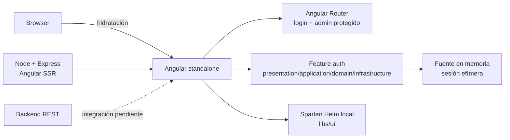

# The Real Maids — frontend

Aplicación web de The Real Maids construida con Angular. El repositorio está en una fase inicial: la base técnica compila, pero las pantallas y los flujos funcionales del ERP todavía no están implementados.

## Estado verificable

- Angular 22 con componentes standalone y TypeScript 6.
- Renderizado SSR con Node/Express, hidratación y prerender de `/login`.
- Tailwind CSS 4 y Spartan UI (`@spartan-ng/brain` + componentes Helm copiados en `libs/ui`).
- Login responsive P01 con Angular Signal Forms, conectado a una fuente en memoria con credenciales de demostración.
- Sesión efímera con Angular signals, guards de usuario/invitado, redirección segura y logout.
- Rutas lazy `/login` y `/admin`; `/admin` es un destino temporal protegido, no el dashboard P02.
- `/login` se prerenderiza; el resto de rutas usa renderizado cliente mientras no exista sesión backend.
- Build de producción y 13 pruebas Vitest verificados el 18 de septiembre de 2026.
- Sin integración HTTP real, persistencia JWT, dashboard funcional, E2E, CI/CD ni despliegue verificable.

El detalle y la evidencia se mantienen en [`docs/PROJECT_STATUS.md`](docs/PROJECT_STATUS.md).

## Arquitectura actual



La arquitectura de código implementada y sus límites están descritos en [`docs/ARCHITECTURE.md`](docs/ARCHITECTURE.md). Los módulos RF/HU/P del documento académico siguen siendo alcance funcional previsto, no evidencia de implementación.

## Herramientas y versiones

| Herramienta              | Versión/configuración del repositorio |
| ------------------------ | ------------------------------------- |
| Angular                  | `^22.1.0` (`@angular/core`)           |
| Angular CLI/build        | `^22.1.8`                             |
| TypeScript               | `~6.0.2`                              |
| Node.js local verificado | `v24.21.0`                            |
| npm                      | `11.19.0`                             |
| Unit tests               | Angular unit-test builder + Vitest 4  |
| CSS/UI                   | Tailwind CSS 4 + Spartan UI 1.4       |

## Desarrollo local

```bash
npm ci
npm start
npm run build
npm test
```

`npm test` ejecuta la suite Vitest actual. No hay target `lint` ni `e2e` configurado actualmente.

Para tareas automatizadas sobre Angular se debe usar primero el MCP de Angular CLI configurado en [`.codex/config.toml`](.codex/config.toml). Para generación de código se usa el Angular CLI local y los schematics del workspace; consulta [`docs/DEVELOPMENT.md`](docs/DEVELOPMENT.md).

## Documentación

- [`AGENTS.md`](AGENTS.md): reglas obligatorias para agentes y automatizaciones.
- [`docs/README.md`](docs/README.md): índice y orden de lectura.
- [`docs/PROJECT_STATUS.md`](docs/PROJECT_STATUS.md): inventario implementado, parcial y pendiente.
- [`docs/ARCHITECTURE.md`](docs/ARCHITECTURE.md): arquitectura real del repositorio.
- [`docs/DECISIONS.md`](docs/DECISIONS.md): decisiones vigentes y asuntos abiertos.
- [`docs/TRACEABILITY.md`](docs/TRACEABILITY.md): relación entre alcance funcional y evidencia de código.
- [`docs/adr/`](docs/adr/): decisiones arquitectónicas persistentes.

## Límites obligatorios

- Angular consume únicamente la API interna del backend mediante REST/JSON.
- QuickBooks Online se integra desde el backend, nunca directamente desde el navegador.
- No se almacenan secretos ni credenciales privadas en el bundle frontend.
- La autorización definitiva pertenece al backend; ocultar opciones o proteger rutas no la reemplaza.
- El mecanismo de persistencia del JWT continúa abierto y no debe fijarse sin ADR.
