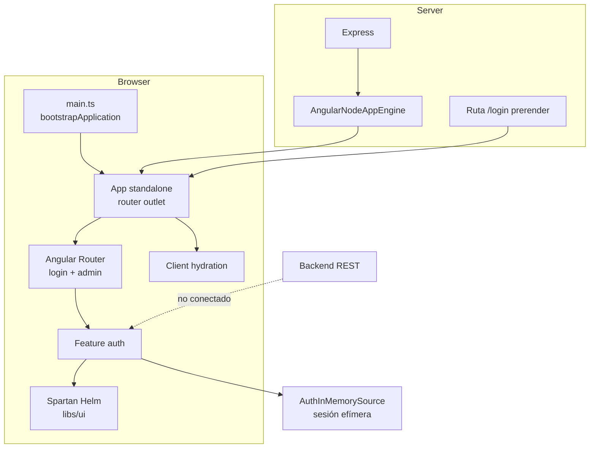
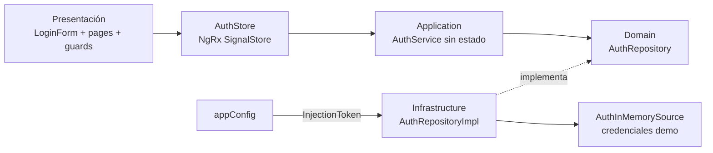

# Arquitectura frontend

## Estado

Este documento describe la arquitectura observada en el repositorio al **2026-09-27**. Cuando menciona módulos de negocio futuros, los marca explícitamente como objetivo.

## Vista de ejecución actual



## Plataforma

- Aplicación Angular 22 standalone.
- TypeScript 6, target ES2022 y módulos `preserve`.
- Builder `@angular/build:application`.
- SSR Angular servido por Express.
- Hidratación en cliente.
- Render mode actual: prerender para `/login` y CSR para el resto.
- CSS global con Tailwind CSS 4 y preset de Spartan.
- Pruebas unitarias mediante el builder oficial y Vitest.

NgRx SignalStore se usa únicamente para el estado compartido de presentación de autenticación. No hay store monolítico, cliente OpenAPI, HttpClient configurado, interceptor, librería i18n ni observabilidad implementados.

## Organización de código real

```text
src/
  app/
    admin/features/auth/
      application/       # servicios de caso de uso y errores
      domain/            # entidad, parámetros y contrato de repositorio
      infrastructure/    # implementación y fuente en memoria
      presentation/
        components/      # formularios y piezas propias de la feature
        guards/          # guards auth/guest propios de la feature
        pages/           # login y destino autenticado temporal
        state/           # AuthStore raíz con NgRx SignalStore
      auth.routes.ts     # rutas lazy login/admin
    admin/features/customers/
      domain/            # Customer y contrato CustomerRepository
      application/       # CustomerService y CustomerError
      infrastructure/    # repositorio y source demo en memoria
      # sin presentation, rutas ni pantalla P04
    core/
      config/            # configuración browser/server y placeholders de ambiente
      services/          # placeholders
      tokens/            # API_URL, todavía sin provider
    shared/utils/        # Result<T, E>
    app.ts               # router outlet raíz
    app.routes.ts        # redirect, carga lazy y wildcard
  environments/          # archivos vacíos
  main.ts                # entrada browser
  main.server.ts         # entrada SSR
  server.ts              # servidor Express/Angular SSR
libs/ui/                 # componentes Spartan Helm copiados al proyecto
```

## Arquitectura por feature y capas

La primera feature vertical implementada es autenticación. Su dirección conceptual de dependencias es:



Reglas para extender esta arquitectura:

- organizar el código por feature, no por una carpeta global de componentes/servicios de negocio;
- mantener entidades y contratos de dominio independientes de Angular cuando sea razonable;
- ubicar la orquestación en `application`;
- ubicar HTTP, almacenamiento u otros adaptadores en `infrastructure`;
- crear una capa `presentation` dentro de la feature para rutas, páginas y componentes propios;
- mantener stores y guards específicos dentro de `presentation`, aunque un store pueda tener alcance root mediante DI;
- reservar `core` para configuración transversal y singletons;
- reservar `shared` para piezas realmente reutilizables y sin conocimiento de una feature concreta.

No se debe replicar mecánicamente todas las capas para código trivial; la separación debe proteger límites reales.

### Esqueleto de customers (M03)

Para esta feature, la nomenclatura de código acordada es `customers`/`Customer*`. El flujo
disponible va de `CustomerService` a `CustomerRepository`, luego a `CustomerRepositoryImpl` y
finalmente a `CustomerInMemorySource`. `findAll` y `findById` devuelven
`Result<..., CustomerError>`; si el identificador no existe, la fuente devuelve
`CUSTOMER_NOT_FOUND`. `DEMO_CUSTOMERS` permanece en
`customer-in-memory.source.ts`, junto a la fuente. No hay consumidor de presentación ni flujo P04.

La dependencia `domain/repositories/customer.repository.ts -> application/errors/customer.error.ts`
contradice la dirección de capas buscada por ADR-009. Es una deuda pendiente de revisión antes
de ampliar la feature; no se ha acordado aún dónde debe vivir ese tipo de error.

## Composición UI

La decisión UI vigente es Spartan + Tailwind, no Angular Material ni Bootstrap.

- Brain (`@spartan-ng/brain`) aporta comportamiento y accesibilidad.
- Helm se genera y mantiene como código local en `libs/ui`.
- Los imports se realizan mediante alias `@spartan-ng/helm/<componente>`.
- Los tokens semánticos del tema viven en `src/styles.css`.
- Antes de crear markup propio se revisan los componentes Spartan instalados/disponibles.

La configuración se encuentra en `components.json`; consulta ADR-006.

Los formularios propios usan Angular Signal Forms como base: el modelo signal es la fuente de verdad, la validación se declara en el schema del formulario y Spartan compone campos y errores mediante `formRoot`/`formField`. No existe un wrapper compartido; consulta ADR-010.

## Bootstrap y providers

`appConfig` registra actualmente:

- listeners globales de error del navegador;
- Angular Router;
- hidratación de cliente;
- binding `AUTH_REPOSITORY -> AuthRepositoryImpl`;
- binding `CUSTOMER_REPOSITORY -> CustomerRepositoryImpl`.

`AuthService` orquesta login y consulta de usuario sin conservar estado. `AuthStore` usa NgRx SignalStore, se provee en root y expone `session` e `isAuthenticated` a componentes, páginas y guards. `LoginFormComponent` encapsula Signal Forms, validación y envío; `LoginPage` conserva la composición de pantalla y la navegación posterior. No se persisten datos en browser storage ni se incorpora JWT; consulta ADR-011.

El servidor combina esa configuración con `provideServerRendering(withRoutes(serverRoutes))`.

## Frontera HTTP objetivo

La frontera aprobada continúa siendo:

`Angular -> API interna REST/JSON -> integraciones/datos`

QuickBooks Online nunca se consume directamente desde Angular. Sin embargo, esta frontera todavía no tiene implementación HTTP en el repositorio. Antes de agregarla se debe:

1. validar el OpenAPI real;
2. proveer la URL base mediante configuración pública por ambiente;
3. tipar DTO y errores;
4. definir sesión/JWT mediante ADR;
5. mantener llamadas fuera de componentes visuales.

## Routing y autorización

El router carga lazy las rutas `/login` y `/admin`. `guestGuard` evita volver al login con sesión activa y `authGuard` protege `/admin`, conservando un `returnUrl` seguro. Todavía no hay permisos por rol y la autorización definitiva seguirá en backend.

`/login` se prerenderiza porque es pública y estable. El resto usa CSR para evitar prerenderizar rutas dependientes de una sesión todavía efímera.

## Módulos funcionales objetivo

M01-M12 y P01-P13 siguen siendo el mapa de alcance proveniente del documento funcional. No corresponden a módulos Angular ni a features implementadas. La cobertura exacta está en [`TRACEABILITY.md`](TRACEABILITY.md).

## Decisiones todavía abiertas

- persistencia y renovación de JWT;
- contrato OpenAPI y generación de cliente;
- extensión de NgRx SignalStore a otras features, solo cuando exista estado compartido demostrado;
- i18n español/inglés;
- política de caché y reintentos;
- observabilidad frontend;
- hosting productivo;
- render mode por ruta cuando existan rutas privadas/dinámicas.
